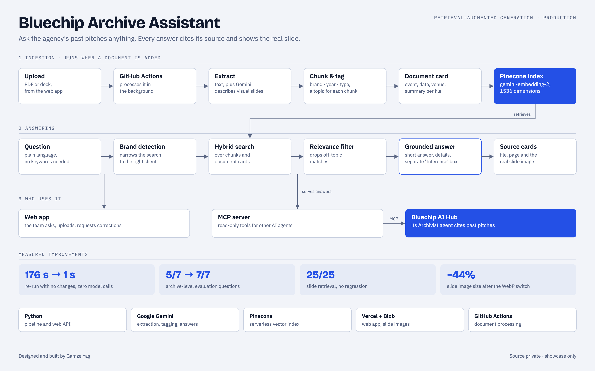

# Bluechip Archive Assistant

**A production RAG system that makes an events agency's past proposals, decks and reports searchable in plain language, with every answer tied to its source slide.**

<picture>
  <source media="(prefers-color-scheme: dark)" srcset="docs/architecture-dark.png">
  
</picture>

> The source code and the archive are private (client data). This repository documents the architecture and the engineering decisions.

## The problem

Years of pitches lived in PDF and PowerPoint files. Questions like *"What did we last do for this client?"* or *"Which workshops did we propose for that event?"* meant someone opening decks one by one.

## How it works

**Ingestion** runs whenever a document is added. The team uploads a file in the web app and GitHub Actions processes it in the background.
1. **Extract** the text. Gemini describes slides that are mostly visual, so they become searchable too.
2. **Chunk and tag** each document with brand, year and type, and each chunk with its topic (stage, cocktail, décor…).
3. **Build a document card** for every file: event name, date, venue and a short summary.
4. **Embed** with `gemini-embedding-2` (1536 dimensions) into a Pinecone serverless index.

**Answering**
1. Brand detection narrows the search to the right client.
2. Hybrid search runs over chunks and document cards.
3. A relevance filter drops off-topic matches.
4. The model answers **only from the retrieved documents**: a one-line answer, then details. Anything inferred rather than stated is shown in a separate **"Inference"** box, so archive facts and model interpretation never mix.
5. Source cards show the file and page, and open the **real slide image**.

**Consumers.** A web app for the team (ask, upload, request corrections) and a read-only **MCP server**. The [Bluechip AI Hub](https://github.com/gamzeyas/bluechip-ai-hub-showcase) multi-agent system uses that MCP server so its Archivist agent can cite past pitches.

## Engineering decisions, measured

| Change | Result |
|---|---|
| Incremental pipeline: unchanged chunks keep their tags, tagged documents are skipped | Re-run with no changes: **176 s → 1 s**, zero model calls, byte-identical output |
| Year-aware document cards for "what did we do most recently" questions | Archive-level evaluation: **5/7 → 7/7** |
| All retrieval changes checked against a fixed slide-search test set | **25/25**, no regressions |
| Slide images switched from JPEG to WebP | **−44%** storage for the same 548 pages |

An evaluation script (`degerlendir.py`) runs after every pipeline change, so improvements are measured rather than assumed.

## Stack

Python · Google Gemini (extraction, tagging, answers, embeddings) · Pinecone · MCP · Vercel + Vercel Blob · GitHub Actions

## My role

Designed and built end to end: ingestion pipeline, retrieval and answer design, evaluation, web app, MCP server and deployment.
